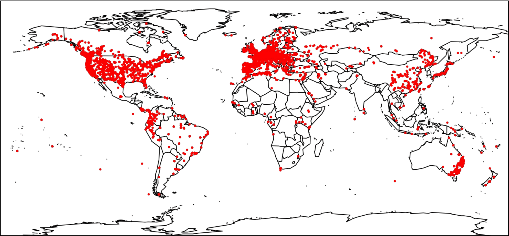

The RepAdapt project aims to learn about the flexibility of adaptation: if different species encounter a similar adaptive challenge, do they use the same genes to adapt? By comparing genome sequence data from thousands of individuals across hundreds of species, we can search for signatures of natural selection within each species and explore the diversity of responses across species. In the early stages of this project, we are focusing on adaptation to climate, and will eventually expand the scope to other selection pressures and traits. Given the importance for crop breeding, we are also particularly interested in comparisons between wild and domestic species. With the recent launch of the [MacroMar](https://macromarnet.github.io/MacroMar/index.html) project, which will greatly expand the number of marine species, we will also explore how changes in the marine environment have driven adaptive responses.

The RepAdapt project began with a study of the genetic basis of repeated adaptation to climate in 25 species of plants. After using Genotype-Environment Association (GEA) methods and finding many genes with significant signatures of repeated local adaptation ([Whiting et al. 2024](https://doi.org/10.1038/s41559-024-02514-5)), we next looked at patterns of repeated selective sweeps ([Nocchi et al. 2024](https://doi.org/10.1073/pnas.2406832121)). Surprisingly, whereas the genes driving local adaptation were enriched for high pleiotropy, the candidates driving global adaptation were enriched for low pleiotropy. This pattern is consistent with expectations from migration-selection theory ([Yeaman 2022](https://doi.org/10.1093/genetics/iyab134)), where local adaptation should be enriched for alleles of large effect. Given that high pleiotropy tends to involve large phenotypic effects ([Wang et al. 2010](https://doi.org/10.1073/pnas.1004666107)), seeing genes with high pleiotropy driving local adaptation is consistent with this broad prediction.\
\
What other predictions from evolutionary theory can we test using comparative population genomics? Ultimately, we would like to learn how constraints in the genotype-phenotype-fitness map give rise to repeated adaptation ([Yeaman et al. 2018](https://doi.org/10.1371/journal.pgen.1007717)). To learn about such constraints, we can compare the extent of repeated adaptation for:

- The same traits/environments across many species across close vs. broad phylogenetic distances

- Different traits that integrate across few vs. many tissues/organs (e.g. colouration vs. cold tolerance vs. body size)

- Response to artificial vs. natural selection

- Global vs. local adaptation (impact of gene flow)

- Species groups with large vs. small effective population size

- Recent/observational patterns (sweeps, GEA, experimental) vs. long-term sustained patterns (dN/dS, etc.)

\
By using a common set of methods to call variants and analyze patterns of genomic variation for signatures of selection, we will have an unprecedented scale at which to study the comparative population genomics of adaptation.

Interested in learning more? [Click Here](more_info.qmd)

## Our Species

The RepAdapt project now has \>180 active members from 18 countries. See more on our collaborators [here](about.qmd).

::: panel-tabset
## World Plot



## Statistics

|             | Number         |
|-------------|----------------|
| Datasets    | 130            |
| Species     | 120            |
| Individuals | 33 000         |
| Populations | 10 000         |
| SNPs        | 12 000 000 000 |

## Species Plot

```{r}
#| column: page
#| fig-width: 10
#| fig-height: 6
library(ggplot2)
species <- data.frame(Species = c("Insects", "Fish", "Birds", "Marine_Invertebrates", "Fungi", "Plants"),
                      Number = c(49, 15, 14, 15, 15, 163))
ggplot(data = species, aes(x=Species, y = Number, fill = Species)) +
  geom_bar(stat = "identity", width =0.5) +
  geom_text(aes(label = Number), vjust = 1.6, colour = "white", size = 3.5) +
  theme_minimal()
```
:::
