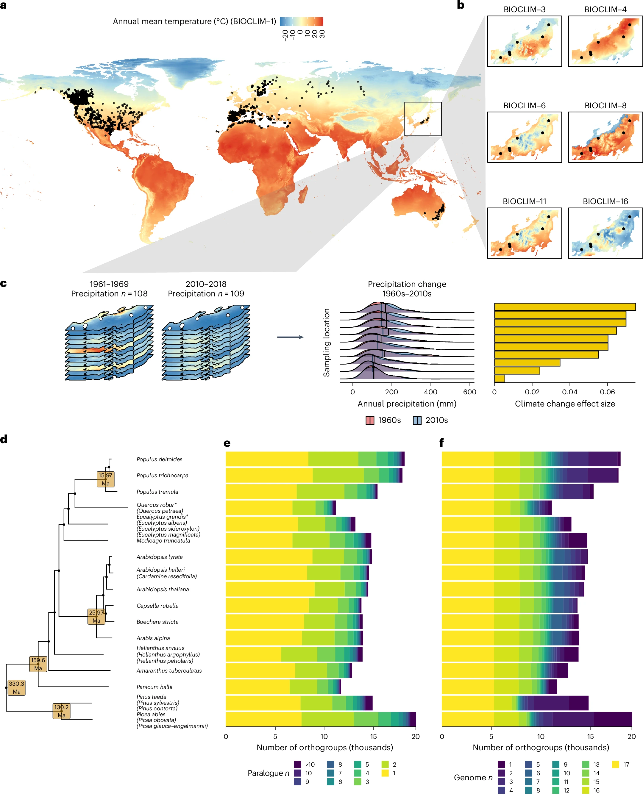
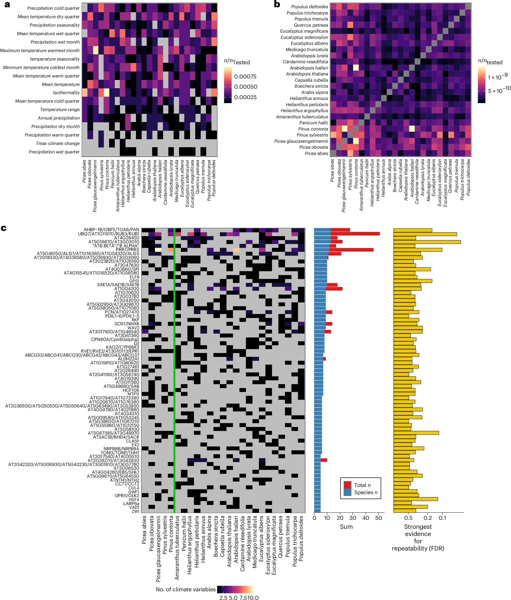
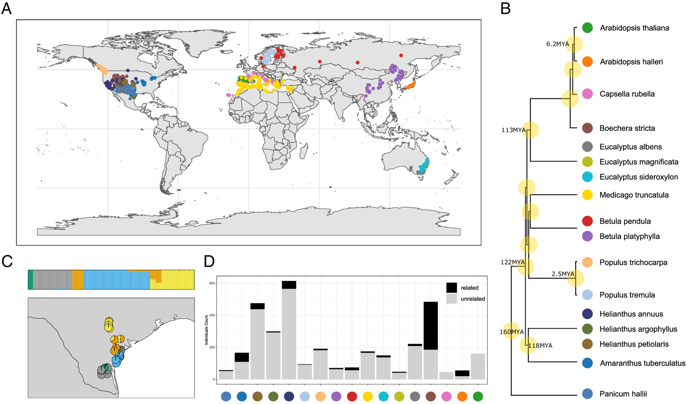
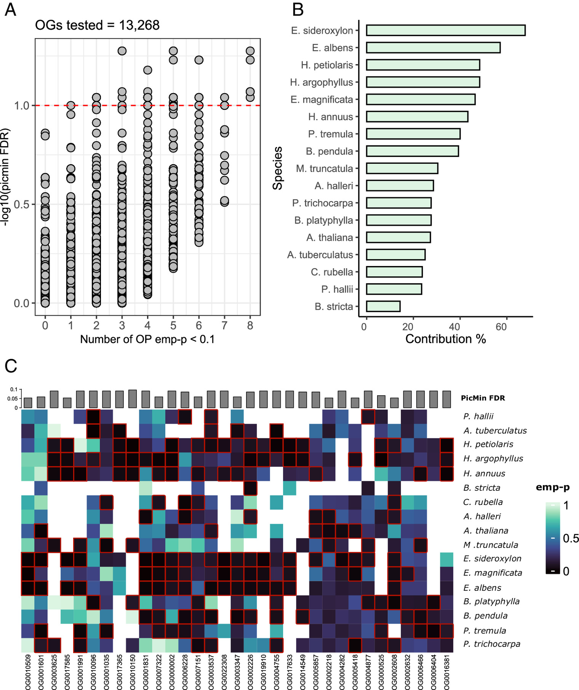

The foundation of the RepAdapt idea comes from two papers published in 2024, looking at repeatability when it comes to local vs global adaptation. These analyses were done with a much smaller dataset than what we have access to now, but they provide a good starting point for futher analysis. 

## The genetic architecture of repeated local adaptation to climate in distantly related plants. (Whitting et al. 2024)

{fig-align="center"}

::: {.callout-note collapse="true"}
## Figure 1.

a, Sampling locations from all 29 datasets (25 species) and global annual mean temperature. b, An example of six bioclim variables across a single dataset with ten sampling locations from ref. 65. c, An example for the same dataset showing how climate change variables were calculated, taking monthly climate data from the 1960s and 2010s and calculating the effect size of the difference between decades. d, The species tree derived from the OrthoFinder2 analysis for the 17 reference genomes used in this study; species where a reference genome assembly was used to map related species but that species was not included in analyses, are marked with asterisks. The reference genome assembly at each tip came from the species not listed in brackets and species listed in brackets below had their data mapped onto that reference genome. The age of high-confidence nodes is shown with values pulled from TimeTree (Extended Data Fig. 1). Species analysed here are placed according to the reference genome used and the reference’s position in the tree. e,f, The per genome distribution of the number of paralogues per orthogroup (e) and number of representative genomes per orthogroup (f) are depicted as stacked bars, with bar fill scaling from light-to-dark according to most- to least-statistically tractable value. Bars are ordered vertically in line with the tree in d. Ma, million years ago.
:::

Data used in the analysis was sequenced using multiple methods (whole-genome sequencing, capture-based sequencing or pool-sequencing) but all the reads were passed through a common pipeline to pull out single-nucleotide polymorphisms (SNPs). This use of a common pipeline minimizes the influence of bioinformatic technical artifacts, therefore reducing the total amount of noise present during analysis. Orthogroups were reconstructed using Orthofinder2 to allow for comparison between different species. The resulting orthogroups had both low rates of paralogy, allowing for reduced confounding effects as well as high presence among species, making detection of repeatability easier. The genes with signatures of local adaptation were then determined by testing the association between allele frequencies and the 21 bioclim variables chosen for the study. SNP p-values were combined into gene p-values using weighted-Z analysis to increase power and reduce error. Finally PicMin was used to identify orthogroups with repeated signatures of association across several species.

---

{fig-align="center"}

::: {.callout-note collapse="true"}
## Figure 3.

a,b, Heatmaps show the contribution of individual species to orthogroup repeatability at FDR \< 0.5 for different climate variables (a) and among pairs of species (b), with species ordered phylogenetically. In each case, the fill of each cell represents the proportion of orthogroups where a given species contributes towards the signature of repeatability based on its minimum GEA P value. c, Heatmap showing the number of times a species contributes towards repeatability for a given RAO (FDR \< 0.5). In c, cell fill denotes the number of climate variables where a species contributes a low P value to a given RAO, with grey being 0. The vertical green line separates gymnosperms and angiosperms. Row-wise summations are shown as bars, where the blue bar shows the number of species associated with a given orthogroup (species n) and the red bar shows the total number of species and climate variables (total n). RAOs associated with a single climate variable only have a blue bar and those with stacked red bars are RAOs associated with multiple climate variables. The strongest statistical support for repeatability is also shown per orthogroup as −log10-transformed FDR. Only 73 RAOs with at least five contributing species are shown.
:::

This analysis found 141 repeatedly associated orthogroups (RAOs) with 108 of them unique. It also found that no specific/cluster of species was driving the repeatability signals discovered. Significant orthogroups were also not driven by relatedness between species, showing that the signal of repeatability is spread out across the phylogenetic tree, going against expectations that repeatability is associated with relatedness, declining as relatedness decreases.

## Repeated global adaptation across plant species. (Nocci et al. 2024)

{fig-align="center"}

::: {.callout-note collapse="true"}
## Figure 1.

Geographical distribution and relatedness within and among the study species. (A) Sampling locations of the 17 datasets included in the study. (B)Time-calibrated phylogenetic tree (retrieved from https://timetree.org/) of the 17 datasets, based on 12 reference species. (C) fastSTRUCTURE ancestry pie plot(K = 5) of the Helianthus argophyllus dataset in Texas (USA), showing substantial substructuring. (D) Relatedness filtering summary bar plot by dataset. Datasets labeled by corresponding color from B.
:::

The global adaptation analysis has less species included due to the necessity of whole-genome sequencing for the analysis. However, geographical breadth is largely the same between the two studies and the same bioinformatics pipeline was largely used to allow for accurate comparison. 

---

{fig-align="center"}

::: {.callout-note collapse="true"}
## Figure 3.

Evidence for repeated selectivesweeps across multiple species. (A)Distribution of PicMin FDR (−log10PicMin FDR on the Y axis) for the13,268 tested orthogroups, orderedby number of putative driving geneson the X axis (number of OmegaPlusemp-P < 0.1). Points above the redline have FDR < 0.1. (B) Speciescontribution to PicMin top candidates(FDR < 0.1), calculated for each speciesas: [number of empirical P-values < 0.1in the PicMin FDR < 0.1 orthogroups]/[total number of orthogroups withPicMin FDR < 0.1 tested]. (C) Heatmapof OmegaPlus empirical P-values for the33 candidate orthogroups (PicMin FDR< 0.1); driving genes cells (emp-P < 0.1 –black cells) are outlined in red, speciesare ordered by phylogenetic distancealong the Y axis. A white cell indicatesthat an orthogroup was not tested ina species.
:::

---

### These two studies interestingly display a difference in polygenic genes when looking at local vs global adaptation. In local adaptation polygenic genes are favored for repeatability as their large effect allows them to overcome swamping from migration. In contrast polygenic genes are disfavored in global adaptation due to the cost of complexity hypothesis, wherein mutations to more polygenic genes will possibly cause detrimental impact to a larger number of biological processes. {.unlisted .unnumbered}
